<p align="center"></p>

<h1 align="center">vinoSearch</h1>

<p align="center">Search your files by what's in them with natural language & keywords, from KRunner or GNOME Shell.</p>

<p align="center"></p>

Filename search finds `signing-keys.md` when you remember it's called that. vinoSearch finds it when you remember what it says. It also finds `IMG_2041.jpg` from "dog watching the sunset", because it reads the pixels, not the name.

- **Text and images**, searched from one box. Markdown and plain text, plus photos, documents and source code when you turn them on. Code is searched apart, with `code:` in front of the query.
- **On the NPU.** Indexing runs at ~28.6 chunks/s and 3% of one core, so it doesn't fight you for the CPU. A warm query takes 26 ms (p50).
- **Where you already search.** KRunner and GNOME Shell's overview. A CLI too.
- **Stays current.** inotify picks up changes within seconds, and an hourly check catches anything it missed.
- **Private.** The only network calls download the model and the runtime, and each model file is checked against a pinned SHA-256.

## Requirements

- Linux with an Intel NPU (Core Ultra or newer) and the [NPU driver](https://github.com/intel/linux-npu-driver). No NPU? It runs on the CPU, just slower.
- KDE Plasma or GNOME on Wayland. Sway, Hyprland, COSMIC and other Wayland desktops work through `vinosearch menu` and a dmenu-style launcher.
- x86_64 with glibc 2.39 or newer for the release download (Fedora 40+, Ubuntu 24.04+, Debian 13, Arch, Tumbleweed, Fedora Atomic, Aeon). Anything older builds [from source](docs/install.md#from-source).

## Install

```bash
curl -fsSL https://github.com/karanshukla/vinoSearch/releases/latest/download/install.sh | bash -s -- --index ~/Documents
```

That installs the prebuilt binaries into `~/.local/bin`, fetches OpenVINO and the 340 MB model, indexes the folders you name (`--index` is repeatable, or it asks), and registers vinoSearch with the running desktop's search. No sudo: everything goes in your home. If something is missing (the NPU driver, say), it stops with one line saying what.

| To | Do |
|---|---|
| Upgrade | **Check for updates** on the settings window's About page, or `vinosearch-upgrade` |
| Uninstall | the same `curl` line with `--uninstall` in place of `--index ~/Documents` (keeps your index and settings; `--purge` deletes the index too) |
| Use the Flatpak | [download the bundle](docs/install.md#flatpak) from the latest release |
| Check the install | `vinosearch doctor` |

[Installing](docs/install.md) has the rest: building from source, other distros, Fedora Atomic and openSUSE Aeon, the Flatpak's permissions, and what uninstalling keeps.

## Use it

- **Plasma:** Alt+Space opens KRunner.
- **GNOME:** the overview's search, from the next login.
- **Sway, Hyprland, COSMIC and the rest:** bind `vinosearch menu` to a key. It asks in fuzzel, wofi, rofi, tofi or bemenu.
- **Terminal:** `vinosearch search "how do I rotate the signing key"`, `vinosearch search "code: retry a failed download"`, or `vinosearch similar ~/Pictures/IMG_2041.jpg`.

Results need 3 or more characters. Enter opens the file at the match: a text file at its line, a PDF at its page, audio and video at the time. **Show all results** opens a search window with up to 100 files of each kind, thumbnails and filters.

[Using it](docs/using.md) covers which editors, viewers and players open at the match, the search window, key bindings and the CLI.

## Settings

<p align="center"></p>

Open **vinoSearch** from the app menu, or run `vinosearch-settings`. It shows what's indexed and sets the folders and exclusions, which kinds are on (images, documents, code, vinoWhisper sessions, audio and video), how close a result has to be, the editor and player, the device, and KRunner and GNOME search. Changes apply within 30 seconds, no restart.

Everything it sets lives in `~/.config/vinosearch/config.toml`. [Settings](docs/configuration.md) has the whole file.

## Performance

My own `~/Development` on a Dell XPS 13 (Core 5 320, Wildcat Lake NPU, driver 1.35.0, OpenVINO 2026.4.1), on battery, 2026-10-18. It's a deliberately messy tree: two copies of a kernel driver, the KWin source and generated coverage reports make up 80% of it.

| | |
|---|---|
| Index | 9,763 files, 113,341 chunks, 470 MB on disk |
| Indexing | 66 min, 28.6 chunks/s, 3% of one core (137 s CPU), peak RSS 1.07 GB |
| Indexing power | ~9.2 W system vs 4.5 W idle: ~5.2 Wh for the whole index, about 10% of the battery |
| First model compile | 4.5 s with an empty cache; cached after |
| Cold query (D-Bus activation, model, vectors, query) | 1.7 s |
| Warm query through KRunner | p50 26 ms, p95 46 ms |
| Runner memory, model loaded | 645 MB; 12 MB once it unloads after 5 idle minutes |

Images take 1.3 s and about 4.4 J each on the NPU, with no CPU time beyond decoding.

n=1 machine. Your NPU and your files will differ.

[Performance and models](docs/performance.md) has the models and their benchmarks: EmbeddingGemma 2 for text (0.846 nDCG@10 on BEIR SciFact) and images (84.5 R@1 on Flickr30k), PP-OCRv6 for text in images.

## Privacy

The index is SQLite in `~/.local/share/vinosearch/index.sqlite`, readable only by you (0600, directory 0700). Embeddings can be partly inverted back to their text, so treat the index like the files it covers.

It can be encrypted at rest with SQLCipher, its key sealed to this machine's TPM. Off by default. [Privacy](docs/privacy.md) has what that covers and what it doesn't.

## More

- [vinosearch.vinopilot.ca](https://vinosearch.vinopilot.ca): these docs as a site.
- [How it works](docs/how-it-works.md): indexing, watching, the runner, encryption, the runtime and NPU gotchas.
- [D-Bus interface](docs/dbus.md): KRunner, GNOME Shell and the control interface the settings app uses.
- [Releasing](docs/releasing.md): how a release is cut.
- [Comment style](docs/comment-style.md): for contributors. A rule gets a named test, cited from the code as ``(pinned by `tests::name`)``; `tests/doc_links.rs` checks the citations.

## License

MIT. The models are Apache 2.0: EmbeddingGemma by Google DeepMind, PP-OCRv6 by Baidu's PaddleOCR.
