<p align="center"></p>

<h1 align="center">vinoSearch</h1>

<p align="center">Search your files by what's in them, from KRunner or GNOME Shell. Every model runs on your Intel NPU, and nothing leaves your machine.</p>

<p align="center"></p>

Filename search finds `signing-keys.md` when you remember it's called that. vinoSearch finds it when you remember what it says. It also finds `IMG_2041.jpg` from "dog watching the sunset", because it reads the pixels, not the name.

- **Text and images**, searched from one box. Markdown, plain text and source code, plus photos when you turn them on.
- **On the NPU.** Indexing runs at ~28.6 chunks/s and 3% of one core, so it doesn't fight you for the CPU. A warm query takes 26 ms (p50).
- **Where you already search.** KRunner and GNOME Shell's overview. A CLI too.
- **Stays current.** inotify picks up changes within seconds, and an hourly check catches anything it missed.
- **Private.** The only network calls download the model and the runtime, and each model file is checked against a pinned SHA-256.

It's early days: a working proof of concept, used daily on one laptop. Expect rough edges.

## Requirements

- Linux with an Intel NPU (Core Ultra or newer) and the [NPU driver](https://github.com/intel/linux-npu-driver). No NPU? `--device CPU` works, just slower.
- KDE Plasma or GNOME on Wayland. Sway, Hyprland, COSMIC and other Wayland desktops work through `vinosearch menu` and a dmenu-style launcher (fuzzel, wofi, rofi, tofi or bemenu). The settings window is Wayland only.
- Rust and a C compiler, only to build from source.

## Install

```bash
curl -L https://github.com/karanshukla/vinoSearch/releases/latest/download/vinosearch-x86_64-linux.tar.gz | tar xz
vinosearch/scripts/install.sh --index ~/Documents
```

That installs the prebuilt binaries into `~/.local/bin` (x86_64, glibc 2.39 or newer), fetches OpenVINO and the 308 MB model, indexes the folders you name (`--index` is repeatable, or it asks), and registers vinoSearch with the running desktop's search (KRunner on Plasma, GNOME Shell on GNOME) as a service started at login. It skips whatever is already done, so re-running it from a newer download upgrades in place. If something is missing (the NPU driver, say), it stops with one line saying what.

`vinosearch/scripts/install.sh --uninstall` removes the service, the KRunner and GNOME files and the binaries. Add `--purge` to also delete the index, model, compiled cache and runtime.

<details>
<summary>From source instead</summary>

Needs Rust and a C compiler. The same script builds the binaries with cargo into `~/.cargo/bin` when run from a checkout, and `git pull` then a re-run upgrades:

```bash
git clone https://github.com/karanshukla/vinoSearch && cd vinoSearch
scripts/install.sh --index ~/Documents
```

Or step by step:

```bash
cargo install --path .                     # vinosearch into ~/.cargo/bin
cargo install --path crates/settings       # vinosearch-settings, the settings window (optional)
cargo install ovfetch                      # 0.5.0 or newer
scripts/install-runtime.sh                 # OpenVINO via ovfetch
vinosearch fetch-model                     # 308 MB, every file checked against a pinned SHA-256
vinosearch index ~/Documents ~/Development # once per root; unchanged files are skipped on re-runs
vinosearch krunner --install               # the systemd user service, the app menu entry and the running desktop's search
vinosearch integrate gnome                 # or kde: add the other desktop's search; --off removes one
```

`vinosearch doctor` checks the NPU, driver and runtime, then compiles and runs a probe model.

</details>

## Use it

- **Plasma:** Alt+Space opens KRunner. Results come in **vinoSearch Text**, **vinoSearch Documents** and **vinoSearch Images** groups.
- **GNOME:** the overview's search, from the next login.
- **Sway, Hyprland, COSMIC and the rest:** `vinosearch menu` asks for a query in fuzzel, wofi, rofi, tofi or bemenu (the first it finds), shows the results in it, and opens the one you pick. Bind it to a key, e.g. `bindsym $mod+s exec vinosearch menu` in sway or `bind = SUPER, S, exec, vinosearch menu` in Hyprland. `--launcher "rofi -dmenu -i"` (or `VINOSEARCH_LAUNCHER`) picks another dmenu-style command. It asks the running service, so a warm query is as quick as KRunner's.
- **Terminal:** `vinosearch search "how do I rotate the signing key"`, or `vinosearch similar ~/Pictures/IMG_2041.jpg` for indexed photos that look like one.

Results need 3 or more characters. Enter opens the file.

## Settings

<p align="center"></p>

Open **vinoSearch** from the app menu, or run `vinosearch-settings`. On sway or Hyprland, **Add folder…** needs a file chooser portal (`xdg-desktop-portal-gtk` provides one; `xdg-desktop-portal-wlr` doesn't); without it, type the path instead. It shows what's indexed and lets you add folders and exclusions, turn images and documents on, set how close a result has to be, pick the NPU, GPU or CPU, and turn KRunner and GNOME search on or off, each on its own. Changes apply within 30 seconds, no restart.

Everything it sets lives in `~/.config/vinosearch/config.toml`, if you'd rather edit that:

```toml
exclude = ["~/Downloads"]   # never indexed or watched, even under an indexed root
device = "NPU"
idle_unload_minutes = 5     # free the model after this long idle; 0 keeps it loaded

[formats.text]
min_score = 0.65            # lower it for more, looser results

[formats.images]
enabled = true              # off by default: the vision encoder is a 671 MB download
extensions = ["jpg", "jpeg", "png", "webp", "gif", "bmp", "tif", "tiff", "heic", "heif", "avif"]
min_score = 0.63
```

Flags and environment variables override the file. Package trees like `~/snap`, `~/go/pkg` and conda installs are excluded by default; [how it works](docs/how-it-works.md#what-gets-indexed) has the list.

## Performance

My own `~/Development` on a Dell XPS 13 (Core 5 320, Wildcat Lake NPU, driver 1.35.0, OpenVINO 2026.4.1), on battery, 2026-10-18. It's a deliberately messy tree: two copies of a kernel driver, the KWin source and generated coverage reports make up 80% of it.

| | |
|---|---|
| Index | 9,763 files, 113,341 chunks, 470 MB on disk |
| Indexing | 66 min, 28.6 chunks/s, 3% of one core (137 s CPU), peak RSS 1.07 GB |
| Indexing power | ~9.2 W system vs 4.5 W idle: ~5.2 Wh for the whole index, about 10% of the battery |
| First model compile | 4.5 s with an empty cache; cached after |
| Cold query (D-Bus activation, model, vectors, query) | 1.7 s |
| Warm query through KRunner | p50 26 ms, p95 46 ms |
| Runner memory, model loaded | 645 MB; 12 MB once it unloads after 5 idle minutes |

Images take 1.3 s and about 4.4 J each on the NPU, with no CPU time beyond decoding.

n=1 machine. Your NPU and your files will differ.

## Models

Text uses [EmbeddingGemma 2](https://huggingface.co/google/embeddinggemma-2) as [arankays/embeddinggemma-2-text-int8-cw-onnx](https://huggingface.co/arankays/embeddinggemma-2-text-int8-cw-onnx): INT8, 274 MB, with a fix for an OpenVINO conversion bug ([#1](https://github.com/karanshukla/vinoSearch/issues/1)). On BEIR SciFact it scores **0.846 nDCG@10**, against 0.582 for the published ONNX export and 0.684 for bge-small. The [full table](docs/how-it-works.md#text-model-benchmark) has 12 models.

Images use its vision encoder, rewritten with static shapes so the NPU can compile it, as [arankays/embeddinggemma-2-vision-static-onnx](https://huggingface.co/arankays/embeddinggemma-2-vision-static-onnx): fp32, 671 MB, downloaded only once images are on. On Flickr30k's 1k test split (1,000 images, 5,000 captions), both stages on the NPU (`bench/image_retrieval.py`, `bench/image_energy.py`):

| Soft tokens | Text→image R@1 / R@5 / R@10 | ms/image | Package J/image |
|---|---|---|---|
| 280 | 86.3 / 97.5 / 98.7 | 2767 | 9.4 |
| **140 (used)** | **84.5 / 96.9 / 98.6** | **1311** | **4.4** |
| 70 | 81.1 / 95.4 / 97.9 | 653 | 2.2 |

## Privacy

The index is plaintext SQLite in `~/.local/share/vinosearch/index.sqlite`, readable only by you (0600, directory 0700). Embeddings can be partly inverted back to their text, so treat the index like the files it covers. Encryption at rest is [#4](https://github.com/karanshukla/vinoSearch/issues/4).

## More

- [How it works](docs/how-it-works.md): indexing, watching, the runner, the settings window, the runtime and NPU gotchas.
- [D-Bus interface](docs/dbus.md): KRunner, GNOME Shell and the control interface the settings app uses.

## License

MIT. The models are Apache 2.0, by Google DeepMind.
