# Settings



Open **vinoSearch** from your application menu or run `vinosearch-settings`. The settings window lets you inspect index status, manage indexed and excluded folders, enable optional formats (images, documents, code, vinoWhisper sessions, audio and video), adjust match score thresholds, pick your editor and media player from installed apps, choose between NPU, GPU, and CPU, and toggle KRunner and GNOME Shell search independently. Changes apply within 30 seconds without restarting. See [Each setting](how-it-works.md#each-setting) for full descriptions.

On sway or Hyprland, the **Add folder…** button requires a file-chooser portal (`xdg-desktop-portal-gtk` provides one; `xdg-desktop-portal-wlr` does not). Without one, type the folder path directly.

## The config file

Everything configured in the UI is saved to `~/.config/vinosearch/config.toml`, which you can also edit directly:

```toml
exclude = ["~/Downloads"]   # never indexed or watched, even under an indexed root
device = "NPU"
idle_unload_minutes = 5     # unload the model after this many idle minutes; 0 keeps it loaded
editor = "code"             # opens text results at their line [default: system default]; or "org.kde.kate.desktop", or "foot -e nvim +{line} {file}"
player = "mpv"              # plays media results at their timestamp (mpv, vlc, or celluloid) [default: system default]; or "mpv --start={seconds} {file}"

[formats.text]
min_score = 0.65            # lower values return more, looser matches

[formats.images]
enabled = true              # off by default; requires downloading the 671 MB vision encoder
extensions = ["jpg", "jpeg", "png", "webp", "gif", "bmp", "tif", "tiff", "heic", "heif", "avif"]
min_score = 0.68

[formats.code]
enabled = true              # off by default; matched only by queries starting with "code:"
min_score = 0.72

[formats.sessions]
enabled = true              # off by default; indexes vinoWhisper saved transcripts and summaries

[formats.media]
enabled = true              # off by default; indexes audio and video by sound and frames (requires ffmpeg)
min_score = 0.68
max_minutes = 60            # off by default; skip longer audio and video files (changing this applies to previously seen files too)
```

Audio and video indexing ([#187](https://github.com/karanshukla/vinoSearch/issues/187)) runs after all other indexing work, on AC power only, processing five minutes of media at a time: 10-second audio windows sampled every 5 seconds (skipping silent sections) plus one video frame per shot. One hour of video takes roughly 6.5 to 9 minutes of NPU time, mostly for frame encoding. Enabling media downloads the audio encoder (295 MB) as well as the vision encoder (671 MB) if images are not already enabled.

CLI flags and environment variables override settings in `config.toml`. Package trees such as `~/snap`, `~/go/pkg`, and conda environments are excluded by default; see [What gets indexed](how-it-works.md#what-gets-indexed) for the full list.
