# Settings



Open **vinoSearch** from the app menu, or run `vinosearch-settings`. It shows what's indexed and lets
you add folders and exclusions, turn images, documents and code on, set how close a result has to be
and pick the editor that opens text results and the player that plays audio and video from your
installed apps, pick the NPU, GPU or CPU, and
turn KRunner and GNOME search on or off, each on its own. Changes apply within 30 seconds, no
restart. [How it works](how-it-works.md#each-setting) goes through each setting.

On sway or Hyprland, **Add folder…** needs a file chooser portal (`xdg-desktop-portal-gtk` provides
one; `xdg-desktop-portal-wlr` doesn't); without it, type the path instead.

## The config file

Everything the window sets lives in `~/.config/vinosearch/config.toml`, if you'd rather edit that:

```toml
exclude = ["~/Downloads"]   # never indexed or watched, even under an indexed root
device = "NPU"
idle_unload_minutes = 5     # free the model after this long idle; 0 keeps it loaded
editor = "code"             # opens text results at their line [default: the default app]; or "org.kde.kate.desktop", or "foot -e nvim +{line} {file}"
player = "mpv"              # plays media results at their time (mpv, vlc or celluloid) [default: the default app]; or "mpv --start={seconds} {file}"

[formats.text]
min_score = 0.65            # lower it for more, looser results

[formats.images]
enabled = true              # off by default: the vision encoder is a 671 MB download
extensions = ["jpg", "jpeg", "png", "webp", "gif", "bmp", "tif", "tiff", "heic", "heif", "avif"]
min_score = 0.63

[formats.code]
enabled = true              # off by default; found only by queries starting "code:"
min_score = 0.72

[formats.sessions]
enabled = true              # off by default; vinoWhisper's saved transcripts and summaries

[formats.media]
enabled = true              # off by default; audio and video by sound and picture, needs ffmpeg
min_score = 0.62            # provisional, to be tuned on a real library
max_hours = 3               # longer files are left out; a change applies to files already seen
```

Audio and video ([#187](https://github.com/karanshukla/vinoSearch/issues/187)) are indexed after everything else, on AC
only, five minutes of media at a time: 10 s windows of sound every 5 s, quiet ones skipped, and a frame per shot. An hour
of film is about 6.5 to 9 minutes of the NPU's time, most of it frames. Turning it on downloads the audio encoder (295 MB) and the vision
encoder (671 MB) if images haven't already.

Flags and environment variables override the file. Package trees like `~/snap`, `~/go/pkg` and conda
installs are excluded by default; [what gets indexed](how-it-works.md#what-gets-indexed) has the list.
